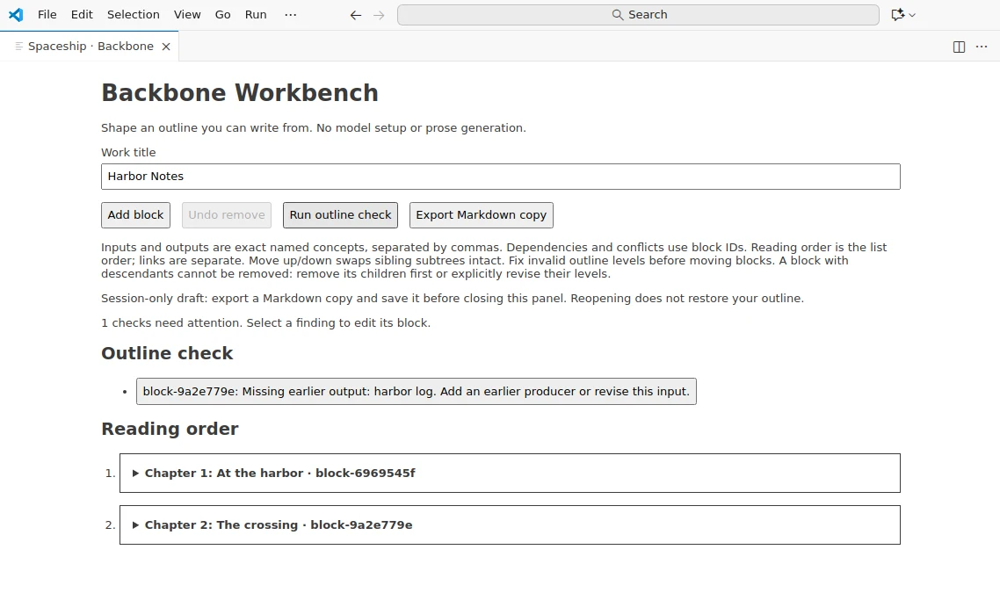
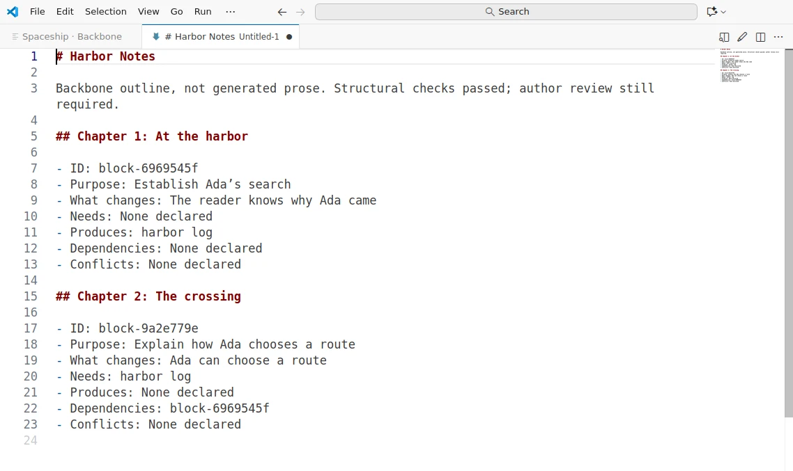
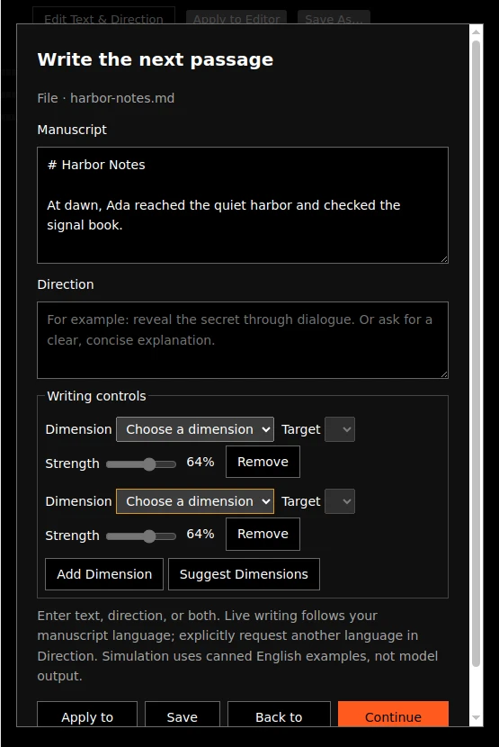

# Spaceship Writer for VS Code

An independent, MIT-licensed adaptation of [Chuanqi Sun’s Spaceship IDE](https://github.com/chuanqisun/spaceship) for writing in VS Code, not a language-specific edition. Open a manuscript or selection, steer a continuation with independent controls, then apply it as a native undoable edit. Chinese remains supported alongside English and other languages.

[Install from Visual Studio Marketplace](https://marketplace.visualstudio.com/items?itemName=brentlee-personal.spaceship-writer) · [Download the 0.3.0 VSIX](https://github.com/brentlee-personal/spaceship-vscode/releases/download/v0.3.0/spaceship-writer-0.3.0.vsix) · [Watch the 30-second Linux demo (MP4)](https://github.com/brentlee-personal/spaceship-vscode/releases/download/v0.3.0/spaceship-writer-0.3.0-linux.mp4)

For a manual install, download the VSIX, then run **Extensions: Install from VSIX…** in VS Code and select the file. See the [extension guide](extension/README.md) for model setup and [community intake](docs/community-intake.md) for feedback.

## Quick start: build a backbone

Open the Command Palette and run **Spaceship: Open Backbone Workbench**. You don't need a manuscript, model, or API key.

### 1. Build the outline

Select **Add block** for each chapter or section. Give it a name, purpose, and what changes for the reader. Set its outline level; **Move up** and **Move down** reorder sibling blocks with their children intact.

### 2. Dry-run the structure

Declare what each block **Needs** and **Produces** in matching terms, or set an explicit prerequisite with **Dependency block IDs**. Select **Run outline check**. In the demo, Chapter 2 needs `harbor log`, but no earlier block produces it.



### 3. Fix it and rerun

Click the finding to jump to its block. Add `harbor log` to Chapter 1’s **Produces** field, then run **Run outline check** again. The check catches structural issues, not the quality of the writing.

### 4. Export a separate copy

Select **Export Markdown copy** to open a **new, unsaved Markdown document**. Your original manuscript stays unchanged. Save the Markdown copy before closing the Workbench.



The Workbench makes no model calls and doesn't generate prose. Editing is **session-only** in 0.3.0: a saved Markdown copy is readable, but cannot be reopened in the Workbench for structured editing. Screenshots and video show a synthetic example in VS Code on Linux.

## Continue a manuscript: Writing Desk

Run **Spaceship: Open Writing Desk** to steer a continuation using independent dimensions, targets, and strengths. **Simulation** shows canned English text, not live generation. In **Live** mode, continuation follows your manuscript's language unless you request another in **Direction**. [See Writing Desk usage and model setup](extension/README.md).

<details>
<summary>Show the Writing Desk controls in Simulation mode (Linux)</summary>



</details>

Spaceship Writer adapts Chuanqi Sun’s original **Future Vector Steering** design for VS Code. Thanks to Chuanqi for suggesting a demo and an upstream contribution in [the original project’s issue #6](https://github.com/chuanqisun/spaceship/issues/6). This is an independent adaptation, not an upstream release or endorsement. See the [upstream issue review](docs/upstream-issues.md).

## Build and contribute

Requires Node.js 24 and npm. Run `npm ci`, `npm test`, and `npm run package:extension`; the VSIX is created in `extension/`. Use `npm run dev` for browser development. The extension identifier remains `brentlee-personal.spaceship-writer`.

We welcome writers, extension developers, accessibility testers and co-maintainers. See [CONTRIBUTING](CONTRIBUTING.md) and [help wanted](https://github.com/brentlee-personal/spaceship-vscode/issues?q=is%3Aissue%20is%3Aopen%20label%3A%22help%20wanted%22). Please test English, Chinese, and other manuscript languages without treating the interface language as the output language.

## Original project

The following is the original author's project introduction. Its hosted browser demo and browser-stored provider keys are separate from this extension's local gateway configuration.

# 🕹️ Spaceship IDE

Steer your ideas in realtime, space pilot style!


## Demos

Watch on [Instagram](https://www.instagram.com/reels/DfyQPhFtW-z/) and [YouTube](https://www.youtube.com/watch?v=3WmNLWUmcnY). You can try the simulator at [https://chuanqisun.github.io/spaceship/](https://chuanqisun.github.io/spaceship/) with the option to go live with your API keys for Cerebras and Gemini. Keys stay in your browser local storage. Do it at your own risk.

## Conjecture

> In the near future, LLM and Decision Models will reach 60 FPS interactivity.

When that happens, what new interaction paradigms will unlock? This project demonstrates plausible and desirable interactions for that future.

1. **Focus monitor**: can we visualize what LLM is paying attention to, and use that to guide human's focus towards what's important?

   

2. **Attention lock**: can we force LLM to pay more attention to specific phrases so as to bias its future behavior?

   

3. **Future Vector Steering**: can we decompose the task into eigenvectors, independently tune each, and re-compose them to influence the incoming text?

   

4. **Realtime re-generation**: when text generation is cheap and fast, can we explore alternative futures by scrubbing?

   

## Design process

I used Claude Code for most of the implementation but stayed hands-on for the UI/UX. I iterate using interactive style swatch, a technique where I prompt AI to give me diverse options of designs, I provide feedback, and it iterates. You can see the design artifacts in the [extra page](https://chuanqisun.github.io/spaceship/extra/style-1.html).

To achieve the realtime experience, I have to use agreesive speculative generation and manage cache invalidation based on user interactions. For example, when the main knob moves backward, I have to empty future texts and cancel ongoing requests. There are many considerations like this throughout the system and that took a lot of human judgement - claude didn't one shot them.

## Theory

I'm currently focusing on systems that help human shape ideas in realtime. This project is a small step towards my [upcoming thesis](https://code.chuanqisun.com/master-thesis/) at the MIT Media Lab, where I investigate how semantic and symoblic systems can be coupled to enhance human creativity, agency, and joy of craft.

## Citation

If you build on this work, please cite it as:

```bibtex
@misc{sun2026spaceship,
  author       = {Sun, Chuanqi},
  title        = {Spaceship {IDE}: Steer Your Ideas in Realtime, Space Pilot Style},
  year         = {2026},
  publisher    = {GitHub},
  howpublished = {\url{https://github.com/chuanqisun/spaceship}},
  note         = {Demo: \url{https://chuanqisun.github.io/spaceship/}}
}
```
